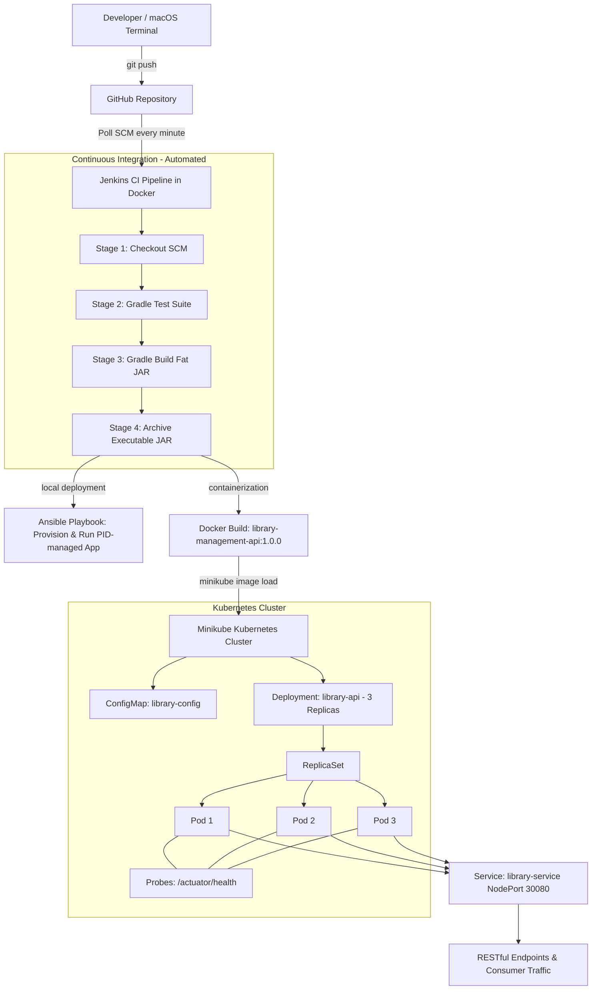

# Library Management System – Automated CI/CD Pipeline and Kubernetes Deployment

[](https://adoptium.net/)
[](https://spring.io/projects/spring-boot)
[](https://gradle.org)
[](https://www.docker.com/)
[](https://kubernetes.io/)
[](https://www.ansible.com/)

---

## 1. Project Overview & Abstract

The **Library Management System** is an enterprise-grade RESTful application integrated with a comprehensive, industry-standard DevOps automation pipeline. The project demonstrates:
- **Layered Spring Boot 3.4.3 architecture** with JPA and H2 in-memory storage.
- **Git Feature Branching Workflow** (`main`, `feature/book-management`, `feature/borrowing-management`, `feature/ci-pipeline`) and conflict resolution demonstrations.
- **Automated Continuous Integration (CI)** with Jenkins running in a dedicated LTS Docker container, triggered automatically via Poll SCM, executing unit and integration tests before archiving artifacts.
- **Configuration Management & Deployment** via Ansible with local idempotency and non-systemd process control on macOS.
- **Production Containerization** with multi-stage Docker builds, Alpine/JRE non-root execution (`appuser`), and resource boundary enforcement.
- **Container Orchestration with Kubernetes (Minikube)**: Declarative deployments with 3 replicas, zero-downtime Rolling Updates, auto self-healing, readiness/liveness probes via Spring Boot Actuator, and horizontal scaling.

---

## 2. Technology Stack & Verified Versions

| Tool | Version Verified | Role |
|---|---|---|
| **OS** | macOS Tahoe (Apple Silicon `arm64`) | Host Operating System |
| **Java** | OpenJDK 17.0.21.0.3 | Application Runtime Environment |
| **Framework** | Spring Boot 3.4.3 | REST Microservice & JPA Layer |
| **Build Tool** | Gradle Wrapper 8.12.1 | Dependency resolution, compilation & packaging |
| **Continuous Integration** | Jenkins LTS (JDK 17 Docker container) | Automated pipeline execution & artifact archiving |
| **Config Management** | Ansible 14.6.0 (`core 2.21.6`) | Agentless host provisioning & deployment |
| **Container Engine** | Docker Desktop 4.84.0 (`29.6.2`) | Container build & image runtime |
| **Container Base** | Eclipse Temurin 17 JRE | Non-root runtime image base |
| **Orchestration** | Kubernetes v1.37.0 (Minikube 1.39.0) | Cluster scheduling, self-healing & scaling |

---

## 3. End-to-End System Architecture



### Architectural Separation
1. **Flow A (CI):** Fully automated by Jenkins. Code is fetched from Git, built and tested with `./gradlew`, and packaged into an executable JAR.
2. **Flow B (CD / Orchestration):** Run deliberately via Ansible or Kubernetes manifests to guarantee explicit control over rollout, rollback, and scaling.

---

## 4. API Reference Documentation

Base URL: `http://localhost:8080` (or `http://localhost:8082` via Kubernetes port-forward)

### Book Management Endpoints
- `GET /books` - List all books (200 OK)
- `GET /books/{id}` - Get book details by ID (200 OK, 404 Not Found)
- `POST /books` - Create new book (201 Created with `Location` header, 400 Validation, 409 Duplicate ISBN)
- `PUT /books/{id}` - Update book (200 OK, 400 Bad Request, 404 Not Found, 409 Conflict)
- `DELETE /books/{id}` - Delete book (204 No Content, 404 Not Found, 409 Conflict if active borrowings exist)
- `GET /books/category/{category}` - Case-insensitive filter (200 OK)
- `GET /books/search?title={query}` - Title substring search (200 OK, 400 if param missing)
- `GET /books/available` - Filter books where `availableCopies > 0` (200 OK)

### Borrowing Endpoints
- `POST /borrowings` - Borrow a book (201 Created, 400 Validation, 404 Book Not Found, 409 No Copies Available)
- `GET /borrowings` - Retrieve all borrowing transactions (200 OK)
- `GET /borrowings/{id}` - Get borrowing details by ID (200 OK, 404 Not Found)
- `GET /borrowings/active` - Filter active borrowings (`status == BORROWED`) (200 OK)
- `PUT /borrowings/{id}/return` - Return a borrowed book (200 OK, 404 Not Found, 409 Already Returned)

### Actuator Monitoring
- `GET /actuator/health` - Health probe returns `{"status":"UP"}`
- `GET /actuator/info` - Build details & application version

---

## 5. Verification Commands

### Run Local Build & Test Suite
```bash
./gradlew clean test
./gradlew build
java -jar build/libs/library-management-api-1.0.0.jar
```

### Run Ansible Local Deployment & Idempotency
```bash
cd ansible
ansible-playbook --syntax-check -i inventory.ini playbook.yml
ansible-playbook -i inventory.ini playbook.yml   # 1st run: changed > 0
ansible-playbook -i inventory.ini playbook.yml   # 2nd run: changed = 0 (Idempotent)
```

### Run Docker Container
```bash
docker build -t library-management-api:1.0.0 .
docker run -d -p 8080:8080 --name library-api library-management-api:1.0.0
docker exec library-api whoami  # returns appuser
```

### Deploy to Kubernetes & Minikube
```bash
minikube start --driver=docker
minikube image load library-management-api:1.0.0
kubectl apply -f k8s/
kubectl rollout status deployment/library-api
kubectl get pods -o wide
```

### Run End-to-End Verification Script
```bash
./scripts/verify.sh http://localhost:8080
```

---

## 6. Known Limitations & Architectural Notes
- **In-Memory H2 Storage:** H2 in-memory is local to each JVM process. In a multi-replica Kubernetes Deployment, each Pod has its own separate database instance. In production, a distributed database like PostgreSQL is used.
- **macOS Process Management:** macOS lacks `systemd`. Ansible deploys via a templated control script (`run-app.sh.j2`) utilizing POSIX PID tracking.
